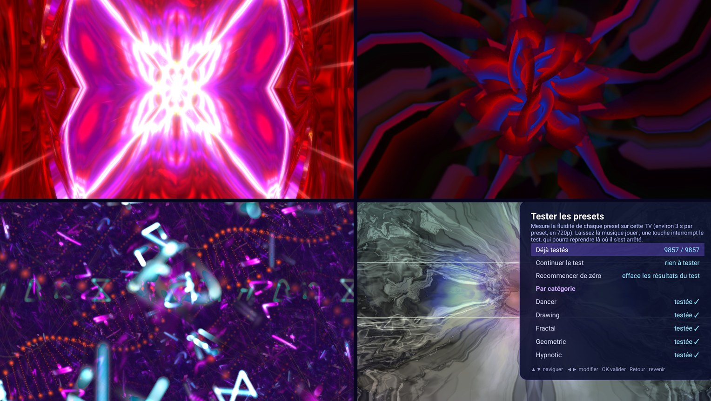

  

  <a href="../README.md"> English</a>
  /
  <a href="README.de.md"> Deutsch</a>
  /
  <a href="README.it.md"> Italiano</a>
  /
  <a href="README.es.md"> Español</a>
  /
  <a href="README.sv.md"> Svenska</a>
  /
  <a href="README.fr.md"> Français</a>

# Lactea — visualizador musical para Android TV

Lactea convierte la música que suena en tu TV en imágenes psicodélicas, como el famoso plugin
**MilkDrop** de Winamp. Reacciona a **cualquier app que reproduzca sonido**: Spotify, Deezer,
YouTube Music, Tidal, Plex… Sigues usando tu app de música como siempre; Lactea escucha lo que
suena en la TV y dibuja.

Se basa en [projectM](https://github.com/projectM-visualizer/projectm), la reimplementación libre
de MilkDrop, y reproduce los presets originales de MilkDrop: casi **10 000 visualizaciones** creadas
por la comunidad de MilkDrop durante veinte años.

Versión actual: **0.1.0, en desarrollo**. Todavía no se ha publicado ninguna versión. Por ahora, la
interfaz está en francés.

## Funciones

- **Reacciona a toda la música que suena en la TV**, sea cual sea la app, también cuando el sonido
  va a una barra de sonido por HDMI (ARC / eARC).
- **9857 presets**: 66 incluidos y el resto en 10 packs temáticos que se descargan desde las
  opciones. Todos los presets de la colección se cargan, gracias a las correcciones hechas en
  projectM (ver más abajo).
- **Título y portada del álbum** en pantalla cuando cambia la canción; la portada también puede
  aparecer dentro de algunas visualizaciones.
- **Se abre solo** cuando empieza la música y se cierra cuando se detiene (opcional).
- **Salvapantallas**: Lactea puede ser el salvapantallas de la TV.
- **Pensado para el mando**: cada acción tiene su tecla, y cada tecla se puede cambiar.
- **Hasta 4K**, con un modo Auto que elige la mejor resolución para cada preset.
- **Fluido incluso en TV modestas**: Lactea sabe cuánto pesa cada preset, puede saltarse los lentos
  y elige entre fundido y corte para que las transiciones no den tirones.
- **Favoritos y exclusiones**, un navegador de presets, un modo aleatorio y un bloqueo del preset
  actual.

## Requisitos

- Una TV o un dispositivo con **Android TV o Google TV**, Android 8.0 o posterior, con OpenGL ES 3.0.
- Probado en una **Sony BRAVIA** (Google TV, chip gráfico Mali-G57).
- Unos 8 MB para la app, y unos 30 MB de descarga para todos los packs de presets.

## Instalación

1. Descarga `Lactea-….apk` desde la página [Releases](https://github.com/Karlos-fr/lactea/releases).
2. Instálalo en la TV, por ejemplo con una app de gestión de archivos desde una memoria USB, o desde
   un ordenador: `adb install Lactea-….apk`.
3. Abre **Lactea** desde la lista de apps de la TV.
4. Lactea pide el **permiso de micrófono**: acéptalo. Android lo exige para que una app pueda seguir
   el sonido que reproduce la TV. Lactea no usa ningún micrófono y no graba nada: solo lee el nivel
   del sonido, muchas veces por segundo, para animar las imágenes.

Después, pon música en cualquier app y vuelve a Lactea.

### Permisos opcionales

Algunas funciones necesitan permisos que Android TV no pide en pantalla. Concédelos desde los
ajustes de la TV si los ofrece, o una sola vez desde un ordenador con
[adb](https://developer.android.com/tools/adb) (opciones para desarrolladores y depuración activadas
en la TV):

| Función | Permiso | Desde un ordenador |
|---|---|---|
| Título y portada de la canción | Acceso a las notificaciones | `adb shell cmd notification allow_listener fr.lactea/fr.lactea.nowplaying.NowPlayingListener` |
| Se abre solo cuando suena música | Mostrar sobre otras apps | `adb shell appops set fr.lactea SYSTEM_ALERT_WINDOW allow` |
| Lactea como salvapantallas | — | `adb shell settings put secure screensaver_components fr.lactea/fr.lactea.dream.LacteaDreamService` |

Para volver a tu salvapantallas anterior, anota primero su nombre con
`adb shell settings get secure screensaver_components` y vuelve a ponerlo de la misma manera.

## Mando a distancia

| Tecla | Acción |
|---|---|
| ◀ ▶ | Preset anterior / siguiente |
| ▲ ▼ | Sensibilidad de audio + / − |
| OK | Mostrar el título de la canción |
| **Mantener OK** | **Options** (siempre, no se puede cambiar) |
| 🔴 Rojo | Bloquear el preset actual |
| 🟢 Verde | Activar / desactivar el modo aleatorio |
| 🟡 Amarillo | Añadir a / quitar de favoritos — mantener: excluir el preset |
| 🔵 Azul o Menú | Options — mantener Azul: navegador de presets |
| Info | Nombre del preset — mantener: lista de teclas |
| Canal + / − | Canción siguiente / anterior |
| Reproducir / Pausa, ⏭ ⏮ | Se envían a tu app de música |
| 0 | Contador de imágenes por segundo |
| Atrás | Cerrar un panel y después salir de Lactea |

Cada tecla se puede cambiar en **Options › Télécommande** (mando a distancia), con una pulsación
corta o larga.

## Opciones

Mantén pulsado **OK** para abrir las opciones. Están agrupadas por tema:

- **Visuel** (imagen): resolución de renderizado (de 540p a 4K, o Auto), resolución máxima en modo
  Auto, imágenes por segundo (30 o 60), detalle de la malla, contador de imágenes por segundo.
- **Presets et transitions** (presets y transiciones): cuánto dura cada preset, fundido o corte
  (Auto elige para cada preset), cortes al ritmo, modo aleatorio, solo favoritos, nombre del preset
  al cambiar.
- **Titre du morceau** (título de la canción): se muestra al cambiar de canción, cuánto tiempo,
  dónde, de qué tamaño; nuevo preset con cada canción.
- **Pochette** (portada): con el título, latiendo al ritmo, dentro de las visualizaciones, búsqueda
  en internet cuando la app de música no da portada.
- **Lancement automatique et économiseur** (inicio automático y salvapantallas): abrir cuando suena
  música (tras cuánto tiempo, solo apps de música), cerrar cuando la música se detiene.
- **Gestion des presets** (gestión de presets): navegador, excluir los presets lentos, packs para
  descargar, probar los presets en esta TV (ver más abajo), reiniciar las mediciones, vaciar la
  lista de exclusiones.
- **Audio**: sensibilidad, modo de captura (nivel constante, o según el volumen).
- **Télécommande** (mando a distancia): cambiar las teclas.

## Packs de presets

Lactea incluye 66 presets. El resto de la colección está repartido en 10 packs (Dancer, Drawing,
Fractal, Geometric, Hypnotic, Particles, Reaction, Sparkle, Supernova, Waveform), que se descargan
desde **Options › Gestion des presets › Packs de presets**. Instala solo los temas que te gusten y
quítalos cuando quieras.

## Presets lentos

Algunos presets exigen mucho al chip gráfico. En la Sony BRAVIA usada para las pruebas, en 720p:

| | Presets | Proporción |
|---|---|---|
| Fluidos (55 imágenes por segundo o más) | 6318 | 64 % |
| Correctos (45–55) | 736 | 7 % |
| Pesados (20–45) | 1364 | 14 % |
| Demasiado pesados (menos de 20) | 1439 | 15 % |

Lactea viene con estas mediciones, así que **Exclure les presets lents** (excluir los presets
lentos) funciona desde el primer inicio. A medida que se reproduce cada preset, Lactea vuelve a
medirlo en tu TV y usa sus propias cifras.

Para medir todos los presets en tu TV de una vez: **Options › Gestion des presets › Tester les
presets sur cette TV** (probar los presets en esta TV). Elige todo o un solo tema; unos 3 segundos
por preset (unas 8 horas para toda la colección). Deja la música sonando; cualquier tecla detiene
la prueba, y puede continuar donde se quedó.

## Limitaciones conocidas

- Por ahora, la interfaz está **solo en francés**.
- El salvapantallas todavía no se ha probado en una TV real.
- Cuando el sonido va a auriculares o altavoces **Bluetooth**, es posible que Lactea no lo reciba.
- Para descargar los packs, el repositorio de GitHub tiene que ser público, y todavía no lo es.
- Algunos presets pierden parte de su animación: 7 por errores que el propio MilkDrop rechazaba,
  7 por una [diferencia que aún hay que corregir en projectM](https://github.com/projectM-visualizer/projectm-eval/issues/23).

## Cómo se hizo Lactea

- **projectM, corregido.** Lactea usa su propia versión de projectM 4.1.8:
  [Karlos-fr/projectm](https://github.com/Karlos-fr/projectm). Al probar los 9857 presets en una TV
  se vio que 67 de ellos no se cargaban en absoluto, porque projectM leía sus ecuaciones de forma
  distinta a MilkDrop. La corrección sigue el código fuente de MilkDrop y se comprobó con los
  144 906 bloques de ecuaciones de la colección, sin ninguna regresión. Se ha propuesto al equipo
  de projectM ([issue](https://github.com/projectM-visualizer/projectm/issues/1083),
  [pull request](https://github.com/projectM-visualizer/projectm/pull/1084)).
- **Medido en la TV.** Cada preset se cargó y se cronometró en la TV, de ahí las cifras de arriba.
- **IA, con total transparencia.** Lactea se escribió con un agente de programación con IA,
  **Anthropic Claude** (Claude Code), y su logo se dibujó con **OpenAI Codex**. Una persona dirige
  el proyecto, prueba en la TV y decide.

Para compilar Lactea tú mismo: [BUILDING.md](BUILDING.md) (en inglés).

## Créditos y licencias

- [projectM](https://github.com/projectM-visualizer/projectm): LGPL 2.1. La versión modificada por
  Lactea está publicada en [Karlos-fr/projectm](https://github.com/Karlos-fr/projectm).
- Presets: [Cream of the Crop](https://github.com/projectM-visualizer/presets-cream-of-the-crop),
  reunidos y clasificados por ISOSCELES; cada preset pertenece a sus autores, que aparecen en el
  nombre del archivo.
- Texturas: [MilkDrop texture pack](https://github.com/projectM-visualizer/presets-milkdrop-texture-pack).
- MilkDrop fue creado por Ryan Geiss.
